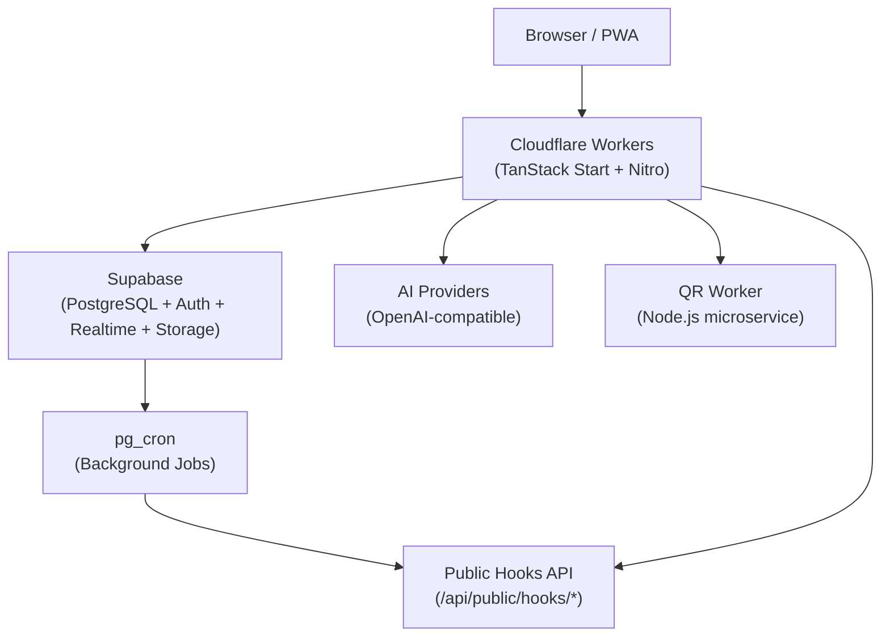
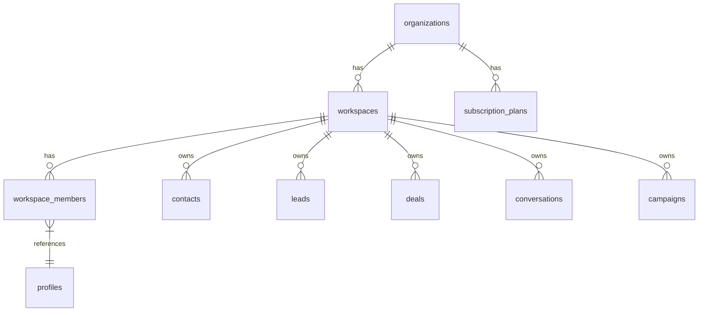
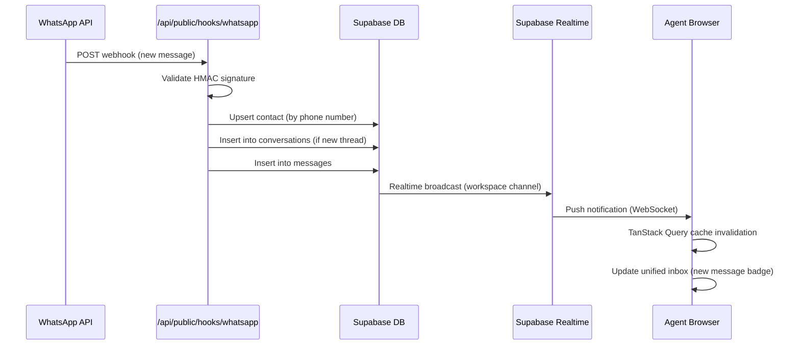

# CYLOO CRM — Architecture Document

> **Package:** `cyloo-crm` v6.8.9  
> **Last Updated:** 2026-11-08  
> **Status:** Production

---

## Table of Contents

1. [Architecture Overview](#1-architecture-overview)
2. [Frontend Architecture](#2-frontend-architecture)
3. [Backend Architecture (Server Functions)](#3-backend-architecture-server-functions)
4. [Database Architecture](#4-database-architecture)
5. [Authentication & Authorization](#5-authentication--authorization)
6. [AI Architecture](#6-ai-architecture)
7. [Omnichannel Communication Architecture](#7-omnichannel-communication-architecture)
8. [Deployment Architecture](#8-deployment-architecture)
9. [Microservices](#9-microservices)
10. [Security Architecture](#10-security-architecture)
11. [Data Flow — New Conversation](#11-data-flow--new-conversation)

---

## 1. Architecture Overview

CYLOO CRM is a full-stack, edge-first, multi-tenant CRM platform. The browser/PWA communicates exclusively with **Cloudflare Workers** (hosting the TanStack Start/Nitro SSR runtime). Workers fan out to Supabase (Postgres, Auth, Realtime, Storage), AI providers, and the WhatsApp QR microservice. Background automation runs entirely inside the database via `pg_cron`, surfacing through public hook endpoints.



| Layer | Technology | Notes |
|---|---|---|
| Edge runtime | Cloudflare Workers | Primary deployment target |
| SSR framework | TanStack Start + Nitro | Vite 8 build pipeline |
| Database | Supabase PostgreSQL | 380 tables, 237 migrations |
| Auth | Supabase Auth + custom RBAC | JWT + RLS |
| Realtime | Supabase Realtime | WebSocket push |
| AI | Vercel AI SDK v7 | Multi-provider, streaming |
| Background jobs | pg_cron | In-database scheduler |
| WhatsApp QR | Node.js microservice (`qr-worker/`) | Unofficial WA Web path |

---

## 2. Frontend Architecture

### Core Stack

| Concern | Library / Version | Notes |
|---|---|---|
| UI framework | React 19 | Concurrent features (Suspense, Server Components) |
| SSR framework | TanStack Start | Nitro adapter → Cloudflare Workers |
| Routing | TanStack Router | File-system routing, 350+ routes |
| Build tool | Vite 8 | With `@tanstack/start` Vite plugin |
| Styling | Tailwind CSS v4 | CSS-first config — **no `tailwind.config.js`** |
| Design system | Radix UI primitives + shadcn/ui pattern | Accessible, composable components |
| Animations | Framer Motion | Page transitions + micro-interactions |
| Charts | Recharts | Analytics dashboards |
| Workflow canvas | ReactFlow | Visual automation builder |
| Forms | React Hook Form + Zod | Type-safe validation |
| Toasts | Sonner | Lightweight notification stack |

### State Management

```
Server state   →  TanStack Query  (caching, background refetch, optimistic updates)
UI/local state →  React useState / useReducer
Real-time      →  Supabase Realtime subscriptions (WebSocket)
```

> [!NOTE]
> There is no Redux or Zustand. All cross-component state sharing that requires persistence goes through TanStack Query's cache. Ephemeral UI state lives in React component state.

### Routing — File-System Convention

Routes live under `src/routes/`. TanStack Router generates a typed route tree at build time.

```
src/routes/
├── __root.tsx              # Root layout (providers, global UI)
├── index.tsx               # Landing / redirect
├── (auth)/
│   ├── login.tsx
│   └── register.tsx
├── (app)/
│   ├── dashboard/
│   ├── contacts/
│   ├── leads/
│   ├── deals/
│   ├── conversations/
│   ├── campaigns/
│   ├── ai/
│   └── settings/
└── api/
    └── public/
        └── hooks/          # Webhook receivers (server-only)
```

> [!IMPORTANT]
> API routes under `src/routes/api/public/hooks/` are **server-only** — they handle inbound webhooks from WhatsApp, Meta, SMS providers, and pg_cron callbacks. They must never import client-only modules.

### Real-Time Integration

Supabase Realtime channels are opened on the client after hydration. Each workspace subscribes to its own channel scoped by `workspace_id`. Updates to `conversations`, `messages`, `leads`, and `deals` trigger live cache invalidation via TanStack Query.

---

## 3. Backend Architecture (Server Functions)

### TanStack Start Server Functions

CYLOO has **no separate REST API layer**. All server-side logic is exposed through TanStack Start's `createServerFn()` — type-safe, co-located procedures that compile to Nitro handler endpoints.

```typescript
// Example: src/server/contacts/getContact.ts
import { createServerFn } from '@tanstack/start'
import { z } from 'zod'

export const getContact = createServerFn({ method: 'GET' })
  .validator(z.object({ id: z.string().uuid() }))
  .handler(async ({ data }) => {
    // Runs in Nitro → Cloudflare Workers runtime
    // Full access to Supabase service-role client
    const { data: contact } = await supabase
      .from('contacts')
      .select('*')
      .eq('id', data.id)
      .single()
    return contact
  })
```

### Runtime Chain

```
Client call → TanStack Start RPC → Nitro handler → Cloudflare Workers → Supabase
```

### Public API Routes

Endpoints that must be reachable without a session (webhooks, cron callbacks):

| Route | Purpose |
|---|---|
| `POST /api/public/hooks/whatsapp` | Incoming WhatsApp Business API events |
| `POST /api/public/hooks/meta` | Meta (Instagram / Messenger) events |
| `POST /api/public/hooks/sms` | SMS provider callbacks |
| `POST /api/public/hooks/email` | Inbound email events |
| `POST /api/public/hooks/cron` | pg_cron HTTP job callbacks |
| `GET  /api/public/hooks/whatsapp` | WhatsApp webhook verification challenge |

> [!WARNING]
> All `/api/public/hooks/*` endpoints **must** validate a provider signature or a shared secret before processing payloads. Skipping validation allows spoofed events.

---

## 4. Database Architecture

### Engine & Scale

| Metric | Value |
|---|---|
| Engine | PostgreSQL (Supabase managed) |
| Tables | 380 |
| Stored functions | 173 |
| RLS policies | 726 |
| Migration files | 237 (in `supabase/migrations/`) |

### Multi-Tenancy

Every tenant-scoped table carries two columns:

```sql
organization_id  uuid  NOT NULL  REFERENCES organizations(id)
workspace_id     uuid  NOT NULL  REFERENCES workspaces(id)
```

RLS policies enforce isolation using JWT claims injected by Supabase Auth:

```sql
-- Canonical RLS pattern
CREATE POLICY "workspace_isolation" ON contacts
  USING (workspace_id = (auth.jwt() -> 'app_metadata' ->> 'workspace_id')::uuid);
```

### Schema Overview



### Key Subsystems

| Subsystem | Tables (examples) | Notes |
|---|---|---|
| CRM core | `contacts`, `leads`, `deals`, `pipelines`, `pipeline_stages` | Full lifecycle |
| Conversations | `conversations`, `messages`, `conversation_participants` | Unified inbox |
| Campaigns | `campaigns`, `campaign_contacts`, `campaign_executions` | Bulk outreach |
| AI | `ai_agents`, `ai_conversations`, `ai_messages`, `knowledge_bases` | RAG + agents |
| Auth / RBAC | `profiles`, `workspace_members`, `roles`, `permissions`, `audit_logs` | Custom RBAC |
| Security | `user_2fa`, `trusted_devices` | 2FA + device trust |
| Background | pg_cron jobs (DB-managed) | Scheduled tasks |
| Secrets | Supabase Vault (`pg_vault`) | Encrypted at-rest |

### Background Jobs (pg_cron)

Scheduled functions are registered directly in PostgreSQL. They either execute SQL logic inline or call back to the application via `/api/public/hooks/cron` with a shared secret.

```sql
-- Example: nightly lead score recalculation
SELECT cron.schedule(
  'recalculate-lead-scores',
  '0 2 * * *',
  $$ SELECT recalculate_all_lead_scores(); $$
);
```

### Migrations

All schema changes must go through versioned migration files:

```
supabase/migrations/
├── 20240101000000_initial_schema.sql
├── 20240115000000_add_campaigns.sql
├── ...  (237 total)
└── 20261108000000_latest.sql
```

> [!CAUTION]
> Never modify an already-applied migration file. Always create a new numbered migration. Supabase tracks applied migrations in `supabase_migrations.schema_migrations`.

---

## 5. Authentication & Authorization

### Authentication Flow

```
User → Supabase Auth (email/password or OAuth)
     → JWT issued with app_metadata claims
     → JWT stored in browser (httpOnly cookie via Supabase SSR helper)
     → Server functions validate JWT on every request
     → RLS policies re-validate workspace/org scope at DB level
```

### Auth Features

| Feature | Implementation |
|---|---|
| Email / password | Supabase Auth built-in |
| OAuth providers | Supabase Auth (Google, etc.) |
| 2FA / TOTP | `user_2fa` table + authenticator app flow |
| Trusted devices | `trusted_devices` table (skip 2FA on known devices) |
| Session management | Supabase JWT + refresh tokens |

### RBAC Model

```
Organization
└── Workspace
    └── WorkspaceMember (profile + role + permissions[])
```

Custom roles and fine-grained permissions are stored in `workspace_members`. Role checks happen at the server function level (application RBAC) **and** at the database level (RLS).

> [!IMPORTANT]
> Both layers must agree. A user blocked by RBAC at the application layer is also blocked by RLS at the database layer. Defense in depth — neither layer alone is sufficient.

### Bootstrap Protection

First-admin setup is guarded by an environment secret:

```typescript
// Timing-safe comparison to prevent timing attacks
import { timingSafeEqual } from 'crypto'
const valid = timingSafeEqual(
  Buffer.from(provided),
  Buffer.from(process.env.SETUP_BOOTSTRAP_TOKEN!)
)
```

### Audit Logs

All sensitive mutations (role changes, deletions, settings updates) are written to the `audit_logs` table with actor, action, target, and timestamp.

---

## 6. AI Architecture

### SDK & Providers

| Component | Technology |
|---|---|
| SDK | Vercel AI SDK v7 (`ai` package) |
| Provider adapter | `@ai-sdk/openai-compatible` |
| Supported backends | OpenAI, OpenRouter, local models (Ollama-compatible) |
| Streaming | `streamText()` / `streamObject()` — edge-compatible |

### Features

| Feature | Description | Status |
|---|---|---|
| AI Assistant | In-app chat with CRM context | ✅ Implemented |
| Chatbot builder | Visual builder for customer-facing bots | ✅ Implemented |
| Reply suggestions | AI-suggested responses in conversations | ✅ Implemented |
| Conversation summarization | LLM-generated thread summaries | ✅ Implemented |
| Workflow automation | AI-triggered workflow actions | ✅ Implemented |
| Knowledge base / RAG | Vector search via pgvector | ✅ Implemented |
| Agent tool use | Structured tool calling with human-approval gate | ✅ Implemented |

### RAG Architecture

```
Document uploaded
  → Chunked + embedded (OpenAI embeddings or compatible)
  → Stored in `knowledge_base_chunks` (pgvector column)
  → Query time: similarity search → top-K chunks → injected into prompt
```

### Agent Architecture

```
ai_agents table
  ├── system_prompt
  ├── tool_definitions (JSONB)
  ├── model_config (provider, model, temperature)
  └── approval_policy (auto | human-in-loop)
```

Tool executions that modify data (send message, update deal, create task) are gated by `approval_policy`. Human-in-loop actions are queued in `agent_approval_requests` for an agent/admin to confirm.

### Token & Cost Tracking

Every AI request records:
- Input tokens
- Output tokens
- Estimated cost (USD)
- Provider and model
- Workspace / organization attribution

This feeds the billing and usage-limit subsystems.

---

## 7. Omnichannel Communication Architecture

### Channels

| Channel | Integration | Path |
|---|---|---|
| WhatsApp Business | Meta Cloud API (official) | `conversations` table → Realtime |
| WhatsApp QR | `qr-worker/` microservice (unofficial) | For accounts without BSP access |
| Email | Configurable SMTP / provider | Pluggable adapter |
| SMS | Pluggable SMS provider | Pluggable adapter |
| Instagram DM | Meta Business API | `conversations` table |
| Facebook Messenger | Meta Business API | `conversations` table |
| TikTok | TikTok Business API | `conversations` table |
| Web Chat | Embeddable JS widget | WebSocket → Supabase Realtime |

### Unified Inbox Model

All inbound and outbound messages — regardless of channel — are normalized into two tables:

```
conversations  (one per thread, channel-agnostic)
  ├── channel         ('whatsapp' | 'email' | 'sms' | 'instagram' | ...)
  ├── workspace_id
  ├── contact_id
  └── status          ('open' | 'resolved' | 'pending' | 'snoozed')

messages  (one per message, FK → conversations)
  ├── direction       ('inbound' | 'outbound')
  ├── content
  ├── media_url
  └── provider_message_id
```

Real-time delivery to agent browsers uses Supabase Realtime channels scoped to `workspace_id`.

### QR Worker Microservice

The `qr-worker/` service manages WhatsApp Web sessions for clients who cannot access the official Meta Cloud API.

```
qr-worker/
├── src/
│   ├── sessions/     # Per-account WA Web session state
│   ├── websocket/    # QR code stream to browser
│   └── webhook/      # Forwards received messages to main app
└── Dockerfile
```

> [!WARNING]
> The QR-based path uses an unofficial WhatsApp Web protocol. It carries a risk of account ban. It is provided as a fallback only. Prefer the official Meta Cloud API for production accounts.

---

## 8. Deployment Architecture

### A. Cloudflare Workers (Primary)

```
npm run build:cloudflare   →  scripts/build-cloudflare.mjs
npm run deploy:cloudflare  →  wrangler deploy
```

| Component | Cloudflare product |
|---|---|
| SSR + server functions | Cloudflare Workers |
| Session state | Durable Objects |
| Static assets | Cloudflare CDN (R2 / Workers Sites) |
| Edge caching | Cloudflare Cache API |

**Build pipeline (`scripts/build-cloudflare.mjs`):**
1. Run Vite 8 build (client bundle)
2. Run Nitro build with Cloudflare Workers preset
3. Bundle server functions into a single Worker entry
4. Output to `.cloudflare/` / `dist/`

> [!NOTE]
> Cloudflare Workers run in the V8 isolate sandbox — not Node.js. Any dependency that requires Node.js built-ins (`fs`, `net`, `crypto` beyond Web Crypto) must be polyfilled or replaced.

### B. Docker Compose (Self-Hosted)

```yaml
# docker-compose.yml (high-level)
services:
  app:
    build: .
    environment:
      - SUPABASE_URL
      - SUPABASE_ANON_KEY
      - SUPABASE_SERVICE_ROLE_KEY
  nginx:
    image: nginx:alpine
    volumes:
      - ./nginx.conf:/etc/nginx/nginx.conf
  qr-worker:
    build: ./qr-worker
```

| Service | Purpose |
|---|---|
| `app` | Main CRM application (Node.js / Nitro) |
| `nginx` | Reverse proxy + TLS termination |
| `qr-worker` | WhatsApp QR session manager |

> [!TIP]
> For self-hosted production, point Supabase to a self-hosted Supabase stack or a managed Supabase project. The application itself is stateless — all persistence is in Supabase.

### Environment Variables (Required)

| Variable | Used By | Description |
|---|---|---|
| `SUPABASE_URL` | App | Supabase project URL |
| `SUPABASE_ANON_KEY` | App | Public anon key (client-side) |
| `SUPABASE_SERVICE_ROLE_KEY` | App (server) | Service role key (never exposed to browser) |
| `SETUP_BOOTSTRAP_TOKEN` | App (server) | First-admin bootstrap secret |
| `AI_PROVIDER_API_KEY` | App (server) | AI provider key |
| `META_WEBHOOK_VERIFY_TOKEN` | App (server) | WhatsApp/Meta webhook verification |
| `META_APP_SECRET` | App (server) | Meta payload signature validation |

---

## 9. Microservices

| Service | Location | Runtime | Purpose |
|---|---|---|---|
| Main App | `src/` | Cloudflare Workers / Node.js | CRM, omnichannel inbox, AI, marketing, campaigns |
| QR Worker | `qr-worker/` | Node.js | WhatsApp Web QR session management |
| pg_cron | Supabase DB | PostgreSQL | Scheduled background jobs (in-DB) |

> [!NOTE]
> CYLOO is intentionally **not** a microservices-heavy architecture. The main app is a monolith deployed to the edge. Only capabilities requiring persistent TCP connections (WhatsApp Web sessions) are split into a dedicated service.

### Inter-Service Communication

```
Main App  ←→  QR Worker   : HTTP (REST) over internal network / Docker bridge
pg_cron   →   Main App    : HTTP POST to /api/public/hooks/cron (shared secret)
Main App  →   Supabase    : Supabase JS client (REST + WebSocket)
```

---

## 10. Security Architecture

### Threat Model & Controls

| Threat | Control |
|---|---|
| Tenant data leakage | 726 RLS policies on all tenant-scoped tables |
| Secret exposure | Supabase Vault (`pg_vault`) — encrypted at rest |
| XSS via user content | DOMPurify sanitization on all user-generated HTML |
| CSRF | TanStack Start built-in CSRF token protection |
| Rate abuse | Supabase rate limiting + application-level guards |
| Spoofed webhooks | Signature-based verification (HMAC) on all inbound hooks |
| Timing attacks on bootstrap | `crypto.timingSafeEqual` for token comparison |
| Privilege escalation | RBAC check in server functions + RLS at DB layer |
| 2FA bypass | `trusted_devices` table — per-device trust with expiry |

### RLS as Primary Isolation

RLS is not a secondary safeguard — it is the **primary** mechanism ensuring one tenant cannot access another's data, even if application-layer bugs exist.

```sql
-- Every sensitive table follows this pattern
ALTER TABLE contacts ENABLE ROW LEVEL SECURITY;

CREATE POLICY "tenant_isolation" ON contacts
  FOR ALL
  USING (
    organization_id = (auth.jwt() -> 'app_metadata' ->> 'organization_id')::uuid
    AND
    workspace_id    = (auth.jwt() -> 'app_metadata' ->> 'workspace_id')::uuid
  );
```

> [!CAUTION]
> Never use the Supabase **service role key** in client-side code. The service role key bypasses all RLS policies. It must only be used in server functions running in the trusted Cloudflare Workers / Docker runtime.

### Webhook Signature Validation

```typescript
// Canonical pattern for inbound hook validation
import { createHmac, timingSafeEqual } from 'crypto'

function validateMetaSignature(body: string, signature: string): boolean {
  const expected = createHmac('sha256', process.env.META_APP_SECRET!)
    .update(body)
    .digest('hex')
  return timingSafeEqual(
    Buffer.from(`sha256=${expected}`),
    Buffer.from(signature)
  )
}
```

---

## 11. Data Flow — New Conversation

This sequence covers an inbound WhatsApp message arriving from a customer and appearing live in an agent's browser.



### Error & Retry Handling

| Failure point | Behaviour |
|---|---|
| Signature invalid | 403 returned immediately; payload discarded |
| DB insert fails | 500 returned; WhatsApp will retry (up to 72 h) |
| Realtime delivery fails | UI falls back to polling via TanStack Query `refetchInterval` |
| Agent offline | Message persisted in DB; visible on next session |

---

*This document describes the architecture as implemented. UI-only or in-progress features are noted per-section. For database schema details see `supabase/migrations/`. For deployment runbooks see `docs/DEPLOYMENT.md`.*
