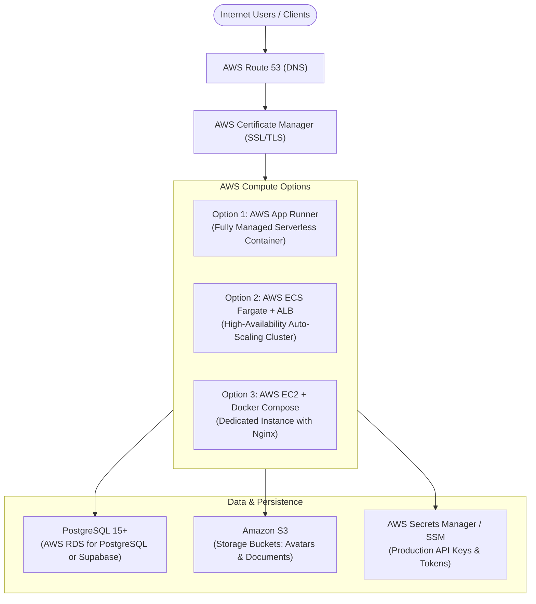

# CYLOO CRM — AWS Production Deployment Guide

**Platform:** CYLOO CRM Enterprise SaaS  
**Version:** 6.8.9  
**Runtime:** Node.js 20/22 | Nitro Standalone Server | Docker  
**Target Cloud:** Amazon Web Services (AWS)  

---

## 1. AWS Architecture Overview

CYLOO CRM is built as a cloud-native, stateless SSR application using **TanStack Start** with **Nitro**. It can be deployed on AWS using any of the following 3 production patterns:



---

## 2. Choosing Your AWS Deployment Path

| Deployment Option | Best For | Estimated Monthly AWS Cost | Setup Complexity | Maintenance |
| :--- | :--- | :--- | :--- | :--- |
| **Option 1: AWS App Runner** *(Recommended)* | Fast deployment, zero server management, automatic SSL & auto-scaling | $15 – $60 / mo | 🟢 Low (15 mins) | Zero (Serverless) |
| **Option 2: AWS ECS Fargate** | Enterprise compliance, private VPC, multi-AZ high availability | $50 – $200 / mo | 🟡 Medium (30 mins) | Low (Containerized) |
| **Option 3: AWS EC2 + Docker** | Maximum cost control, single-instance startup, self-contained | $15 – $35 / mo (`t3.medium`) | 🟢 Low (20 mins) | OS patching required |

---

## 3. Option 1: AWS App Runner Deployment (Recommended)

AWS App Runner is AWS's managed container service. It automatically builds, load-balances, scales, and manages TLS certificates without managing servers or VPCs.

### Step 1: Create an Amazon ECR (Elastic Container Registry) Repository
```bash
# Set your preferred AWS region and account ID
export AWS_REGION="us-east-1"
export AWS_ACCOUNT_ID=$(aws sts get-caller-identity --query Account --output text)

# Create the ECR repository
aws ecr create-repository \
  --repository-name cyloo-crm \
  --image-scanning-configuration scanOnPush=true \
  --region $AWS_REGION
```

### Step 2: Build and Push the Production Docker Image
```bash
# Authenticate Docker to your Amazon ECR registry
aws ecr get-login-password --region $AWS_REGION | docker login --username AWS --password-stdin $AWS_ACCOUNT_ID.dkr.ecr.$AWS_REGION.amazonaws.com

# Build the production image using the existing Dockerfile
docker build \
  --platform linux/amd64 \
  --build-arg VITE_SUPABASE_URL="https://your-project.supabase.co" \
  --build-arg VITE_SUPABASE_PUBLISHABLE_KEY="your-anon-key" \
  --build-arg VITE_APP_ENV="production" \
  -t cyloo-crm:latest .

# Tag and push the image to ECR
docker tag cyloo-crm:latest $AWS_ACCOUNT_ID.dkr.ecr.$AWS_REGION.amazonaws.com/cyloo-crm:6.8.9
docker tag cyloo-crm:latest $AWS_ACCOUNT_ID.dkr.ecr.$AWS_REGION.amazonaws.com/cyloo-crm:latest

docker push $AWS_ACCOUNT_ID.dkr.ecr.$AWS_REGION.amazonaws.com/cyloo-crm:latest
```

### Step 3: Create the App Runner Service via AWS Console or CLI

**In the AWS Console:**
1. Open **AWS App Runner** → Click **Create service**.
2. **Source:** Select **Container registry** → **Amazon ECR**.
3. **Image URI:** Select `cyloo-crm:latest`.
4. **Deployment settings:** Choose **Automatic** (deploys automatically on new image push).
5. **ECR Access Role:** Allow App Runner to create/use the service role.
6. **Configure Service:**
   - **Service name:** `cyloo-crm-prod`
   - **Virtual CPU:** 1 vCPU | **Memory:** 2 GB
   - **Port:** `3000`
   - **Environment Variables:** Add your server secrets:
     - `NODE_ENV`: `production`
     - `PORT`: `3000`
     - `HOST`: `0.0.0.0`
     - `VITE_SUPABASE_URL`: `https://your-project.supabase.co`
     - `VITE_SUPABASE_PUBLISHABLE_KEY`: `your-anon-key`
     - `SUPABASE_SERVICE_ROLE_KEY`: `your-service-role-key`
     - `OPENAI_API_KEY`: `your-ai-key`
     - `SETUP_BOOTSTRAP_TOKEN`: `your-secure-random-token`
7. Click **Create & Deploy**. In ~3 minutes, App Runner will provide your live HTTPS URL (e.g., `https://xxxxxx.us-east-1.awsapprunner.com`).
8. Under **Custom domains**, link your domain (e.g., `crm.yourcompany.com`) with zero-config DNS validation.

---

## 4. Option 2: AWS EC2 Deployment (Docker Compose + Nginx)

For organizations hosting on a dedicated EC2 virtual machine with Nginx handling SSL:

### Step 1: Provision an EC2 Instance
- **AMI:** Ubuntu Server 24.04 LTS (HVM), SSD Volume Type
- **Instance Type:** `t3.medium` (2 vCPU, 4 GiB RAM) or `t4g.medium` (AWS Graviton)
- **Storage:** 30 GB gp3 SSD
- **Security Group Inbound Rules:**
  - `SSH` (Port 22) — Restricted to your IP
  - `HTTP` (Port 80) — 0.0.0.0/0
  - `HTTPS` (Port 443) — 0.0.0.0/0

### Step 2: Server Initialization Script (Run on EC2 via SSH)
```bash
# Connect to your instance
ssh -i your-key.pem ubuntu@ec2-xx-xx-xx-xx.compute-1.amazonaws.com

# Update packages and install Docker
sudo apt update && sudo apt upgrade -y
sudo apt install -y curl git ufw fail2ban

# Install official Docker CE
curl -fsSL https://get.docker.com | sudo sh
sudo usermod -aG docker $USER
newgrp docker

# Verify Docker installation
docker --version
docker compose version
```

### Step 3: Clone Codebase and Setup Environment
```bash
# Clone your CYLOO CRM repository
git clone https://github.com/your-org/cyloocrm.git /home/ubuntu/cyloo
cd /home/ubuntu/cyloo

# Create production environment configuration
cp .env.example .env.production
nano .env.production
```

Ensure `.env.production` contains:
```ini
NODE_ENV=production
PORT=3000
HOST=0.0.0.0
APP_ORIGIN=https://crm.yourcompany.com

VITE_SUPABASE_URL=https://your-project.supabase.co
VITE_SUPABASE_PUBLISHABLE_KEY=your-supabase-anon-key
SUPABASE_URL=https://your-project.supabase.co
SUPABASE_PUBLISHABLE_KEY=your-supabase-anon-key
SUPABASE_SERVICE_ROLE_KEY=your-supabase-service-role-key

OPENAI_API_KEY=your-openai-or-openrouter-key
SESSION_SECRET=generate-a-strong-64-character-random-secret
SETUP_BOOTSTRAP_TOKEN=your-one-time-admin-setup-token
```

### Step 4: Issue Free SSL Certificate (Let's Encrypt / Certbot)
```bash
# Install Certbot
sudo apt install -y certbot

# Issue certificate for your domain (replace with your actual domain)
sudo certbot certonly --standalone -d crm.yourcompany.com

# Copy certificates into the deploy folder
sudo mkdir -p deploy/certs
sudo cp /etc/letsencrypt/live/crm.yourcompany.com/fullchain.pem deploy/certs/
sudo cp /etc/letsencrypt/live/crm.yourcompany.com/privkey.pem deploy/certs/
sudo chown -R $USER:$USER deploy/certs/
```

### Step 5: Launch with Docker Compose
```bash
# Build and launch the multi-container stack in the background
docker compose --env-file .env.production up -d --build

# Verify container health
docker compose ps
docker compose logs -f app
```

### Step 6: Automate Auto-Restart via Systemd
Create a systemd unit so CYLOO CRM starts automatically on EC2 reboot:
```bash
sudo tee /etc/systemd/system/cyloo-crm.service << 'EOF'
[Unit]
Description=CYLOO CRM Enterprise Stack
Requires=docker.service
After=docker.service

[Service]
Type=oneshot
RemainAfterExit=yes
WorkingDirectory=/home/ubuntu/cyloo
ExecStart=/usr/bin/docker compose --env-file .env.production up -d
ExecStop=/usr/bin/docker compose down
TimeoutStartSec=0

[Install]
WantedBy=multi-user.target
EOF

sudo systemctl daemon-reload
sudo systemctl enable cyloo-crm.service
```

---

## 5. Database Deployment (PostgreSQL Migration)

Before opening the application to end-users, ensure the PostgreSQL database schema is applied.

### Option A: Using Supabase Managed Database
```bash
# Push the core enterprise migration to your Supabase project
npx supabase link --project-ref your-project-ref
npx supabase db push
```

### Option B: Using Amazon RDS for PostgreSQL
If running standard PostgreSQL 15+ on AWS RDS:
```bash
# Apply migration directly via psql
psql -h your-rds-instance.rds.amazonaws.com -U postgres -d cyloo_crm -f supabase/migrations/20261108120000_enterprise_core_modules.sql
```

---

## 6. Post-Deployment Verification Checklist

1. **Healthcheck Endpoint:**
   - Execute: `curl -I https://crm.yourcompany.com/healthz`
   - Expected Response: `HTTP/2 200 OK`
2. **Access Setup Wizard:**
   - Navigate to `https://crm.yourcompany.com/install` in your browser.
   - Enter your `SETUP_BOOTSTRAP_TOKEN` to provision the primary Super-Admin account.
3. **Verify Edge Security Headers:**
   - Execute: `curl -I https://crm.yourcompany.com/`
   - Confirm headers: `Content-Security-Policy`, `Strict-Transport-Security`, `X-Frame-Options: SAMEORIGIN`.
4. **Revoke Bootstrap Token:**
   - Once the Super-Admin account is created, clear `SETUP_BOOTSTRAP_TOKEN` from `.env.production` to lock the setup wizard.

