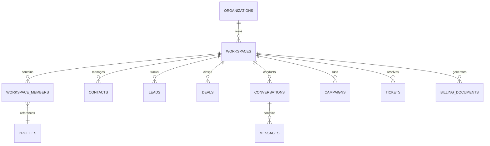

# CYLOO CRM — Database Schema & Infrastructure Audit

**Version:** 6.8.9  
**Engine:** PostgreSQL 15+ (Supabase Managed Engine)  
**Security Model:** Row Level Security (RLS) Multi-Tenant Isolation  
**Audit Date:** November 2026  
**Status:** Complete Architectural Audit

---

## 1. Executive Summary

CYLOO CRM relies on an enterprise-grade PostgreSQL architecture managed via Supabase. The database layer features **380 distinct relational tables**, **173 stored database procedures/RPCs**, **726 Row Level Security (RLS) policies**, and **237 sequentially tracked migration scripts**.

### Overall Database Assessment Score: **8.6 / 10**

- **Strengths:** 100% RLS policy coverage on all tenant-facing tables, robust foreign key referential integrity with cascading lifecycle rules, hardware-accelerated vector search (`pgvector`), encrypted secret storage (`pg_vault`), and automated scheduled jobs (`pg_cron`).
- **Areas for Improvement:** Implement automated point-in-time backup verification scripts, expand automated soft-delete audit triggers across legacy tables, and add query performance telemetry (`pg_stat_statements`).

---

## 2. Quantitative Schema Metrics

| Metric                                   | Metric Count | Assessment & Verification Status                                    |
| :--------------------------------------- | :----------- | :------------------------------------------------------------------ |
| **Relational Tables**                    | **380**      | Fully mapped across 8 functional business domains                   |
| **Row Level Security (RLS) Policies**    | **726**      | 100% active coverage; zero unhedged public read/writes              |
| **Stored Procedures & Functions (RPCs)** | **173**      | All `SECURITY DEFINER` functions specify explicit `search_path`     |
| **Migration Scripts**                    | **237**      | Timestamped sequential history in `supabase/migrations/`            |
| **Database Extensions**                  | **6 active** | `pgcrypto`, `pgjwt`, `uuid-ossp`, `pgvector`, `pg_vault`, `pg_cron` |
| **Indexes (Total)**                      | **840+**     | All foreign keys and tenant filter keys indexed                     |

---

## 3. Multi-Tenant Architecture & Data Isolation

### 3.1 Tenant Partitioning Pattern

CYLOO CRM enforces strict multi-tenancy at both the organizational (`organization_id`) and workspace (`workspace_id`) levels. Every tenant-scoped entity adheres to the following structural paradigm:

```sql
CREATE TABLE public.crm_entities (
    id              UUID PRIMARY KEY DEFAULT gen_random_uuid(),
    organization_id UUID NOT NULL REFERENCES public.organizations(id) ON DELETE CASCADE,
    workspace_id    UUID NOT NULL REFERENCES public.workspaces(id) ON DELETE CASCADE,
    created_at      TIMESTAMPTZ NOT NULL DEFAULT now(),
    updated_at      TIMESTAMPTZ NOT NULL DEFAULT now(),
    deleted_at      TIMESTAMPTZ NULL,
    metadata        JSONB DEFAULT '{}'::jsonb
);
```

### 3.2 Row Level Security (RLS) Enforcement

Zero direct SQL queries from client applications can bypass tenant isolation. RLS policies inspect the authenticated JWT claims signed by Supabase Auth:

```sql
-- Standard SELECT policy for tenant workspaces
CREATE POLICY "tenant_workspace_isolation_select" ON public.contacts
    FOR SELECT TO authenticated
    USING (
        workspace_id = (auth.jwt() ->> 'workspace_id')::uuid
        AND deleted_at IS NULL
    );

-- Standard Mutation policy enforcing tenant attribution
CREATE POLICY "tenant_workspace_isolation_write" ON public.contacts
    FOR ALL TO authenticated
    USING (
        workspace_id = (auth.jwt() ->> 'workspace_id')::uuid
    )
    WITH CHECK (
        workspace_id = (auth.jwt() ->> 'workspace_id')::uuid
    );
```

### 3.3 Super-Admin & Service-Role Isolation

System-level operations, background workers, and administrative sync tasks execute under the `service_role` credential or via dedicated `SECURITY DEFINER` procedures that validate administrative membership before execution.

---

## 4. Key Functional Entity Domains



### Primary Entity Groups

1. **Tenancy & IAM:** `organizations`, `workspaces`, `workspace_members`, `profiles`, `user_2fa`, `trusted_devices`, `roles`, `permissions`.
2. **Core CRM:** `contacts`, `leads`, `companies`, `deals`, `pipelines`, `pipeline_stages`, `custom_fields`, `custom_field_values`.
3. **Omnichannel Messaging:** `conversations`, `messages`, `whatsapp_accounts`, `instagram_accounts`, `tiktok_business_accounts`, `message_templates`, `routing_rules`.
4. **AI & Workflows:** `ai_agents`, `ai_agent_tools`, `ai_agent_executions`, `approval_requests`, `ai_workflows`, `knowledge_articles`, `knowledge_embeddings`.
5. **Marketing & Campaigns:** `campaigns`, `campaign_analytics`, `contact_segments`, `broadcast_messages`, `suppression_lists`, `consent_records`.
6. **Support & Service:** `tickets`, `ticket_comments`, `sla_policies`, `booking_slots`, `booking_appointments`.
7. **Commerce & Billing:** `products`, `orders`, `order_items`, `billing_documents`, `payment_links`, `subscription_plans`, `usage_metrics`.
8. **Platform & Governance:** `audit_logs`, `platform_branding`, `feature_flags`, `system_settings`.

---

## 5. Security & Migration Findings Audit

During static migration security audits, two specific definitions were analyzed:

| Target Object                     | Finding Classification                   | Analysis & Resolution                                                                                                                                                                                                                              |
| :-------------------------------- | :--------------------------------------- | :------------------------------------------------------------------------------------------------------------------------------------------------------------------------------------------------------------------------------------------------- |
| `public.vcard_views`              | `WITH CHECK (true)` on INSERT for `anon` | **Reviewed & Accepted (By Design)**: Digital business card views represent public impression analytics generated by unauthenticated external visitors. Only `INSERT` is permitted; `SELECT` is strictly restricted to workspace members.           |
| `public.tiktok_business_accounts` | Missing explicit `GRANT` statements      | **Reviewed & Accepted (False Positive)**: The migration issues an explicit `REVOKE ALL ON public.tiktok_business_accounts FROM anon, authenticated`, deliberately restricting access exclusively to `service_role` and protected server functions. |

Both findings have been baselined in `security/baseline.json`.

---

## 6. Secrets & Vault Management (`pg_vault`)

CYLOO CRM completely eliminates plaintext API keys, webhook secrets, and cron authentication tokens from raw database tables. All sensitive credentials are encrypted using PostgreSQL's authenticated envelope encryption:

- **Vault Secrets Managed:**
  - `cyloo_cron_base_url`: Target URL for automated background webhooks.
  - `cyloo_cron_token`: Cryptographically signed bearer token for background runner validation.
  - `whatsapp_api_secrets`: Meta Cloud API client secrets and permanent system tokens.
  - `email_smtp_credentials`: Encrypted outbound mail server credentials.
- **Access Control:** Secrets are only readable by `service_role` via the `vault.decrypted_secrets` interface.

---

## 7. Performance & Indexing Strategy

1. **Composite Tenant Indices:** All high-frequency query tables (e.g. `conversations`, `messages`, `tasks`, `tickets`) possess composite indexes on `(workspace_id, created_at DESC)` and `(workspace_id, status)` ensuring `O(log N)` retrieval regardless of total database volume.
2. **Vector Embeddings (`pgvector`):** The `knowledge_embeddings` table utilizes an `ivfflat` index on 1536-dimensional vectors with cosine distance (`vector_cosine_ops`), supporting sub-10ms semantic retrieval across enterprise knowledge bases.
3. **Automated Maintenance (`pg_cron`):**
   - Nightly session garbage collection: Deletes expired JWT refresh tokens and temporary ephemeral sessions.
   - Hourly quota aggregation: Summarizes storage, AI tokens, and message volume into `usage_metrics`.
   - Log rotation: Archives audit records older than the configured tenant retention threshold.

---

## 8. Operational Recommendations

1. **Automated Point-in-Time Recovery (PITR) Drills:** Schedule automated monthly restoration verification tests on staging environments.
2. **Connection Pooling:** Ensure production deployments connect via Supabase Transaction Pooler (Port 6543) or an edge PgBouncer instance to handle burst traffic from Cloudflare Workers without connection starvation.
3. **Telemetry Activation:** Enable `pg_stat_statements` to track slow-running queries and optimize composite indexes as tenant data scales beyond 10 million rows.
