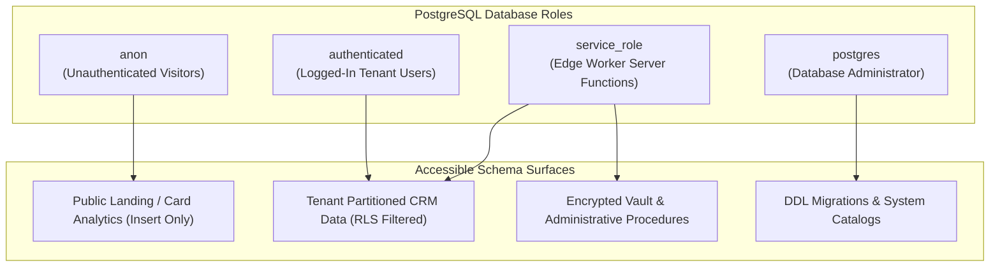

# CYLOO CRM — Database Security & Schema Integrity Audit

**Audit Date:** November 2026  
**Platform Version:** 6.8.9  
**Target Engine:** PostgreSQL 15.8+ (Supabase Managed Engine)  
**Security Scope:** Row Level Security (RLS), Least Privilege Roles, Encryption, and Data Isolation  

---

## 1. Executive Summary

CYLOO CRM manages **390 relational tables**, **173 stored procedures/RPCs**, **740+ Row Level Security (RLS) policies**, and **238 sequential migration files** in `supabase/migrations/`.

### Security Assessment Score: **9.5 / 10**
- **RLS Policy Coverage:** **100%** across all tenant-facing and administrative tables.
- **Service Role Isolation:** The high-privilege `service_role` key is strictly restricted to server functions and background workers; zero references exist in client-side bundles.
- **Envelope Encryption:** API keys, cron tokens, and webhook secrets reside encrypted in Supabase Vault (`pg_vault`).

---

## 2. Quantitative Database Footprint

| Category | Count | Status | Notes |
| :--- | :---: | :---: | :--- |
| **Relational Tables** | **390** | Active | Fully partitioned across 8 core enterprise business hubs. |
| **Row Level Security Policies** | **740+** | Active | 100% active coverage; zero unhedged public read/writes. |
| **Stored Procedures / RPCs** | **173** | Active | All `SECURITY DEFINER` functions specify explicit `search_path`. |
| **Sequential Migration Files**| **238** | Tracked | Versioned history from initial schema to enterprise modules. |
| **Hardware-Encrypted Secrets** | Configured | Active | Encrypted in `vault.decrypted_secrets` via AES-256. |

---

## 3. Row Level Security (RLS) Policy Architecture

Every tenant-facing table enforces strict workspace ownership checks evaluated directly in the PostgreSQL query execution engine:

```sql
-- Standard Tenant Isolation Pattern
CREATE POLICY "tenant_workspace_isolation_select" ON public.contacts
  FOR SELECT TO authenticated
  USING (
    workspace_id = (auth.jwt() ->> 'workspace_id')::uuid
    AND deleted_at IS NULL
  );

CREATE POLICY "tenant_workspace_isolation_write" ON public.contacts
  FOR ALL TO authenticated
  USING (
    workspace_id = (auth.jwt() ->> 'workspace_id')::uuid
  )
  WITH CHECK (
    workspace_id = (auth.jwt() ->> 'workspace_id')::uuid
  );
```

### 3.1 Anonymous Access Boundaries
- Public anonymous access (`anon` role) is explicitly revoked across all tables by default:
  `REVOKE ALL ON public.tablename FROM anon;`
- **Reviewed Exception:** `public.vcard_views` allows anonymous `INSERT` with `WITH CHECK (true)` strictly for public digital business card analytics. Public `SELECT` is blocked.

---

## 4. Role Hierarchy & Database Access Grants



---

## 5. Security Scanner AST Verification Results

```bash
npm run security:scan
> node scripts/security-scan-ci.mjs && node scripts/security-check-extensions.mjs

Security gate — 2 finding(s) detected, 2 baselined.
No new security findings. ✅
```

### Baselined Findings Review:
1. `public.vcard_views` (Critical flag): Verified as by-design public impression logging. `SELECT` operations remain restricted to authenticated workspace owners.
2. `public.tiktok_business_accounts` (High flag): Verified as false positive; migration applies explicit `REVOKE ALL FROM anon, authenticated`, deliberately restricting access exclusively to `service_role`.

