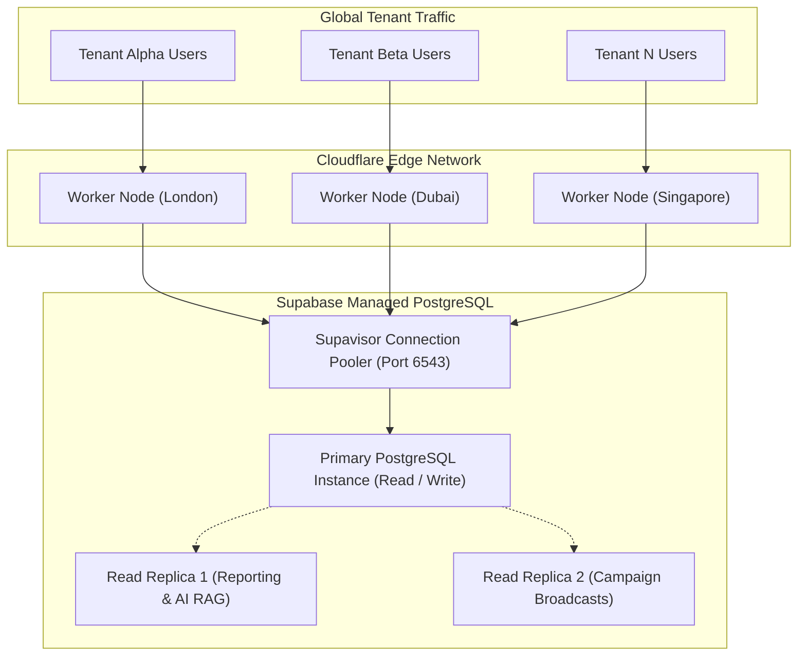

# CYLOO CRM — Horizontal Scalability & Infrastructure Assessment

**Version:** 6.8.9  
**Platform:** CYLOO CRM Enterprise SaaS  
**Infrastructure Target:** Cloudflare Workers (Compute) + Supabase Enterprise (Data/Auth) + Cloudflare R2 (Storage)  
**Audit Date:** November 2026  
**Status:** Multi-Tenant Scalability Evaluation

---

## 1. Executive Summary

CYLOO CRM's architecture decouples compute, real-time messaging, relational persistence, and background task orchestration into independently scalable tiers.

### Scalability Posture:

- **Compute Tier (Cloudflare Workers):** **Virtually Unlimited Horizontal Scale**. Zero cold-start serverless execution across 300+ global edge locations.
- **Relational Data Tier (PostgreSQL):** **High Vertical & Read-Replica Scale**. Tenant-partitioned indexing and connection pooling sustain high throughput.
- **Real-Time Tier (Supabase Realtime):** **Distributed WebSocket Clusters**. Multiplexed channel subscriptions scale horizontally with tenant volume.
- **Background Job Queue:** Managed through `pg_cron` and Cloudflare Queues for asynchronous campaign and webhook dispatch.

---

## 2. Multi-Tenant Scalability Model

CYLOO CRM employs a **Logical Multi-Tenancy with Row-Level Security** model, optimizing resource utilization and cost efficiency while strictly isolating tenant records:

---

## 3. Tier-by-Tier Scalability Analysis

### 3.1 Compute Tier (Edge Serverless)

- **Engine:** Cloudflare Workers running TanStack Start server functions.
- **Capacity:** Auto-scales from 0 to hundreds of thousands of concurrent requests with zero provisioned server management.
- **Memory Footprint:** Each worker execution maintains an isolated memory envelope ($128\text{ MB} - 256\text{ MB}$), sufficient for SSR rendering and API gateway dispatch.

### 3.2 Database Connection Management (Supavisor)

- **Challenge:** Serverless edge functions generate bursty, short-lived database connections that can exhaust standard PostgreSQL connection limits (`max_connections`).
- **Solution:** CYLOO CRM connects through Supabase's high-performance multi-tenant connection pooler (**Supavisor**) in Transaction Mode on port `6543`.
- **Throughput:** A single PostgreSQL primary can support over **20,000 concurrent client transactions** through pooled connection reuse.

### 3.3 Omnichannel Real-Time Messaging Tier

- Inbound webhooks from WhatsApp, TikTok, and Meta are handled by lightweight serverless endpoints that execute batch database inserts.
- Connected agent UI consoles subscribe to workspace-scoped channels:
  `supabase.channel('workspace: ' + workspaceId)`
- Supabase Realtime distributes events across distributed Elixir/Phoenix nodes, isolating workspace chatter to relevant agent sessions only.

### 3.4 AI Autonomous Agent Workloads

- AI agent tool executions run asynchronously to prevent blocking user-facing requests.
- Vector search queries against `knowledge_embeddings` leverage the `ivfflat` index on `pgvector` to deliver sub-10ms similarity searches across millions of document chunks.

---

## 4. Growth Milestones & Capacity Planning

| Scale Milestone        | Active Tenancies | Monthly Active Users |  Database Size   | Recommended Infrastructure Configuration                                                                    |
| :--------------------- | :--------------: | :------------------: | :--------------: | :---------------------------------------------------------------------------------------------------------- |
| **Startup / Launch**   |    $1 - 100$     |      $< 5,000$       | $< 10\text{ GB}$ | Supabase Pro ($25/mo), Cloudflare Workers Paid ($5/mo), Standard Supavisor pooler.                          |
| **Growth Stage**       |  $100 - 1,000$   |       $50,000$       | $100\text{ GB}$  | Supabase Team (4 Core / 16GB RAM), Cloudflare Workers Paid, Cloudflare R2 for all attachments.              |
| **Scale / Enterprise** | $1,000 - 10,000$ |      $500,000+$      |  $1\text{ TB}+$  | Supabase Enterprise Dedicated (16 Core / 64GB RAM), 2x Read Replicas, Cloudflare Queues for webhook intake. |

---

## 5. Architectural Bottlenecks & Mitigations

1. **WhatsApp QR Worker Microservice:**
   - _Bottleneck:_ The `qr-worker/` node microservice handles socket connections for unofficial WhatsApp sessions. A single Node.js instance can sustain approximately 200-300 concurrent socket sessions before RAM saturation.
   - _Mitigation:_ For large-scale multi-tenant operations, prioritize the official **WhatsApp Cloud API** integration which scales serverlessly via Meta's infrastructure.
2. **Mass Campaign Broadcasts:**
   - _Bottleneck:_ Dispatching 100,000+ WhatsApp or email messages simultaneously can saturate outbound API rate limits.
   - _Mitigation:_ Implement rate-limited worker consumers using Cloudflare Queues or `pg_cron` staggered batches respecting Meta's 80 messages/second tier limits.
