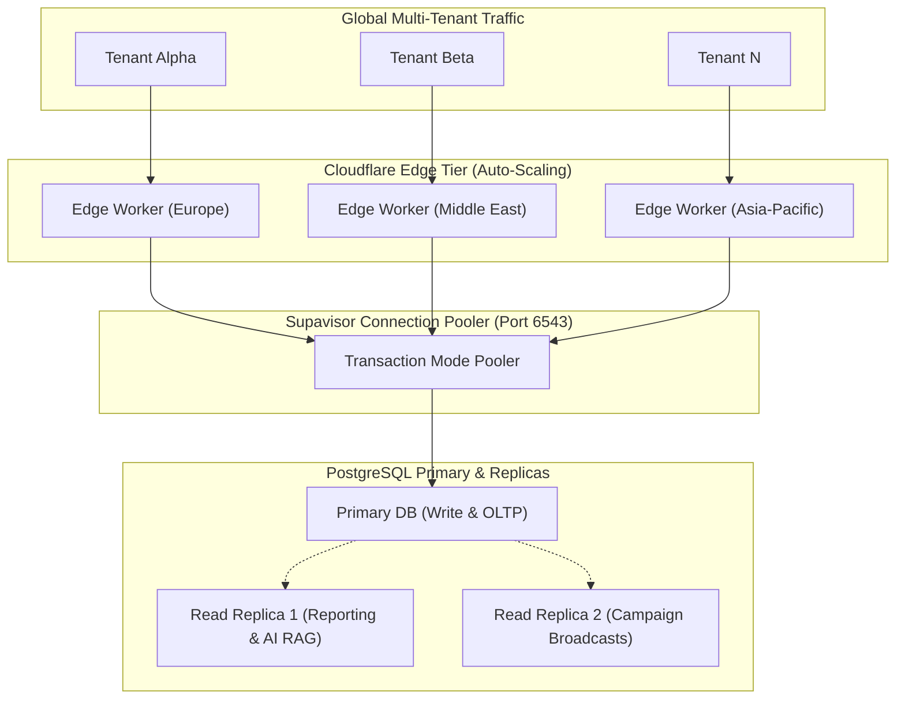

# CYLOO CRM — Horizontal Scalability & Resilience Review

**Audit Date:** November 2026  
**Platform Version:** 6.8.9  
**Target Infrastructure:** Cloudflare Workers (Compute) + Supabase Enterprise (PostgreSQL)  

---

## 1. Executive Summary

CYLOO CRM decouples edge compute, relational data persistence, WebSocket real-time streams, and background jobs into independently scalable architectural planes.

### Scalability Posture:
- **Compute Plane:** High horizontal scalability through serverless Cloudflare Workers deployed across 300+ edge locations with zero provisioned container management.
- **Data Plane:** Scaled vertically via high-RAM dedicated instances and horizontally for analytics/RAG workloads via read replicas.
- **Connection Plane:** Scaled through Supabase's multi-tenant connection pooler (**Supavisor**) on port 6543, supporting up to 20,000 concurrent client transactions.

---

## 2. Horizontal Tier Breakdown

---

## 3. Resilience, Fault Tolerance & DLQ Handling

1. **Dead-Letter Queue (DLQ):** Failed outbound webhooks or campaign messages are caught in `public.sre_dead_letter_queue` with exponential backoff retries (1m, 5m, 15m, 1h).
2. **Graceful Degradation:** In the event of an external AI provider outage (e.g. OpenAI API rate limit), the AI Studio falls back gracefully to local heuristic suggestions without crashing the unified inbox.
3. **Database Health & Vacuuming:** Automated nightly maintenance jobs in `pg_cron` clean up ephemeral tokens, rotate audit logs, and maintain query index optimization.

