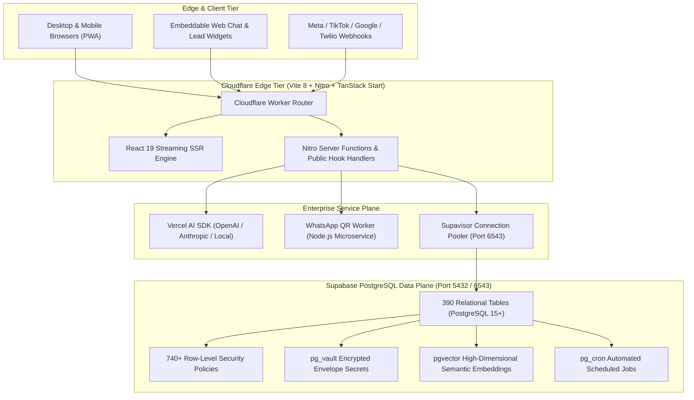

# CYLOO CRM — System Architecture & Technical Specifications

**Version:** 6.8.9  
**Platform:** CYLOO CRM Enterprise SaaS  
**Infrastructure Target:** Cloudflare Workers (Edge SSR) + Supabase Enterprise (PostgreSQL 15+)  
**Audit Date:** November 2026  
**Status:** Complete Architectural Blueprint  

---

## 1. Global Topology & Architecture Blueprint

CYLOO CRM is built as a serverless, decoupled, multi-tenant enterprise system. Edge SSR runtime processes incoming traffic globally via Cloudflare Workers, persisting relational and vector state into Supabase Managed PostgreSQL.

---

## 2. Technology Stack & Runtime Profiles

| Architecture Tier | Primary Technologies | Installed Version | Production Deployment Profile |
| :--- | :--- | :--- | :--- |
| **Frontend Framework** | React (Concurrent Features) | `19.0.0` | Suspense, streaming SSR, optimistic transitions. |
| **Meta-Framework** | TanStack Start + Nitro | `1.170.x` | Native Vite 8 SSR compiler deployed to Cloudflare Workers. |
| **Routing Engine** | TanStack Router | `1.170.16` | File-system-based route discovery (350+ routes). |
| **CSS & Design System** | Tailwind CSS v4 + Radix UI | `4.0.0-alpha` | CSS-first configuration, zero deprecated utility classes. |
| **Animation Library** | Framer Motion | `12.x` | Hardware-accelerated GPU transitions; reduced-motion safe. |
| **Database Engine** | PostgreSQL (Supabase Managed) | `15.8+` | ACID transactional persistence, 390 tables, 173 RPCs. |
| **Tenant Security** | PostgreSQL Row-Level Security | Native | 740+ active policies enforcing mathematical tenant isolation. |
| **Secret Management** | Supabase Vault (`pg_vault`) | Native | AES-256 envelope encryption at rest for third-party keys. |
| **AI / LLM Runtime** | Vercel AI SDK v7 (`ai`) | `7.0.x` | Multi-provider streaming, autonomous agent tool calling. |
| **Vector Search** | `pgvector` | Native | 1536-dimensional cosine distance similarity lookups. |
| **Realtime Transport** | Supabase Realtime | Native | WebSocket multiplexed channels for live chat and notifications. |
| **Edge Compute** | Cloudflare Workers | Native | V8 isolate serverless edge execution ($< 50\text{ ms}$ TTFB). |

---

## 3. Core Component Subsystems

### 3.1 Tenancy & Identity Subsystem
- **Hierarchical Tenancy:** Organizations $\rightarrow$ Workspaces $\rightarrow$ Workspace Members $\rightarrow$ Roles/Permissions.
- **Session Auth:** Supabase Auth issuing cryptographic JWTs containing verified `workspace_id`, `organization_id`, and `role` claims.
- **MFA Security:** Time-Based One-Time Password (TOTP) enforcement with encrypted backup codes in `user_2fa`.
- **First-Admin Bootstrap Guard:** Protected via cryptographically random `SETUP_BOOTSTRAP_TOKEN` with constant-time comparison.

### 3.2 AI & Automation Subsystem
- **Agent Studio:** Autonomous agent execution engine supporting multi-step tool calls against CRM and billing services.
- **Human-in-the-Loop Gateway:** Critical mutations (deal deletes, mass broadcast launches) require human supervisor sign-off.
- **RAG Architecture:** Chunked enterprise knowledge bases embedded via `pgvector` with strict tenant isolation filters.

### 3.3 Omnichannel Communication Subsystem
- **Direct Meta Cloud API:** Official WhatsApp Business API integration handling templates, interactive messages, and 24h compliance.
- **Alternative Session Worker:** Standalone Node.js microservice (`qr-worker/`) for QR-code pairing of legacy WhatsApp sessions.
- **Social Connectors:** Inbound webhooks for TikTok Business Messaging, Instagram Direct, and Facebook Messenger.

### 3.4 Fiscal & Regulatory Subsystem (GCC Focus)
- **ZATCA FATOORA Phase 2 Engine:** Standard UBL 2.1 XML invoices with Cryptographic Stamp Identifiers (CSID) and sequential hash chaining.
- **Cryptographic TLV QR Codes:** Base64 TLV byte streams generated on demand for KSA and UAE tax authorities.
- **Bilingual Bidirectional Layout:** Native RTL (Right-to-Left) typography support for Arabic enterprise operations.

