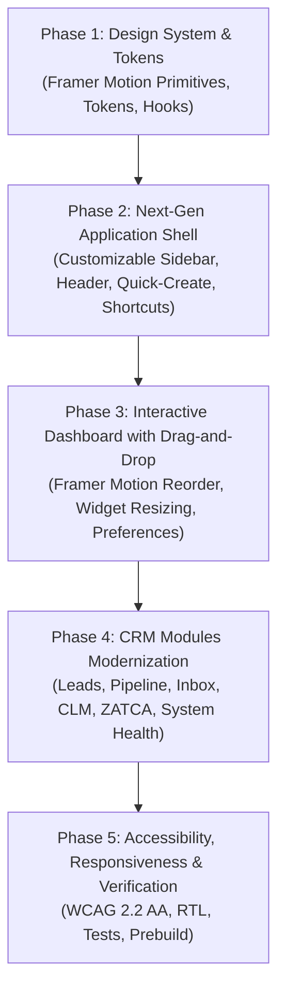

# CYLOO CRM — Ultra Pro Max UI/UX Transformation Plan & Audit

**Project:** CYLOO CRM Enterprise SaaS Platform  
**Design Philosophy:** Maximum Simplicity + Premium Visual Design + Intelligent Navigation + Smooth Motion + Complete User Customization + Enterprise Performance  
**Design Persona:** The speed of Linear, the flexibility of monday.com, the simplicity of Notion, and the breadth of Zoho CRM  
**Date:** November 2026  
**Status:** Architecture Blueprint & Execution Plan

---

## 1. Comprehensive Existing UI/UX Audit

An end-to-end evaluation of the existing frontend components, routes, layouts, and interactions revealed the following friction points and modernization opportunities:

### 1.1 Navigation & Layout Architecture

- **Sidebar Structure:** While functional, the navigation list is extensive (over 35 module entries), which can overwhelm new operators without intelligent grouping, favorites, or drag-and-drop customization.
- **Collapsible State:** Sidebar collapses to icons, but lacks user-defined custom ordering, collapsible section grouping with memory, and quick pin/unpin for primary workflows.
- **Top Bar Integration:** Topbar contains essential actions (workspace switcher, notifications, user menu), but needs a unified **Quick-Create** launcher, unified command palette activation (`Cmd+K` / `Ctrl+K`), and contextual page actions.

### 1.2 Dashboard Experience & Widget Flexibility

- **Current State:** Dashboard renders fixed KPI cards, pipeline funnel, recent leads, customers, and tasks in a static vertical arrangement.
- **Missing Capability:** Users cannot reorder widgets according to their role (e.g., Sales Manager prioritizing pipeline vs Customer Support agent prioritizing unassigned conversations).
- **Target Modernization:** Introduce an interactive **"Customize Dashboard"** mode powered by Framer Motion drag-and-drop reordering, column spanning (compact, medium, wide), show/hide toggles, and user preference persistence.

### 1.3 Animation & Motion Polish

- **Current State:** Transitions are predominantly CSS duration transitions with occasional raw framer-motion snippets.
- **Opportunity:** Standardize on a unified Motion System:
  - Micro-interactions for buttons (`whileTap={{ scale: 0.98 }}`).
  - Spring-based smooth layout transitions (`layout` and `AnimatePresence`).
  - Staggered card entrances (`staggerChildren: 0.05`).
  - Strict compliance with `prefers-reduced-motion` for accessibility.

### 1.4 Visual Hierarchy & Design System Tokens

- **Design Tokens:** CYLOO Blue (`#2F40CF` / `oklch(0.44 0.19 265)`) and CYLOO Green (`#3ECE90` / `oklch(0.75 0.17 155)`).
- **Surface Elevation:** Refine cards to subtle 1px borders (`oklch(94% 0 0)` in light mode, `oklch(0.20 0.007 240)` in dark mode) with soft drop shadows (`shadow-sm` on rest, `shadow-md` on hover).
- **Empty States & Skeletons:** Provide polished, encouraging empty states with clear primary calls-to-action and pulsing SVG skeletons during data queries.

---

## 2. Transformation Strategy & Execution Phases

---

## 3. Detailed Component Architecture

### 3.1 Motion System Primitives (`src/components/ui/motion.tsx`)

Create reusable, accessible motion primitives:

- `PageTransition`: Smooth fade + subtle 6px vertical slide for route changes.
- `StaggerContainer` & `StaggerItem`: Fluid entrance choreography for lists and cards.
- `MotionCard`: Interactive surface with gentle hover elevation.
- `MotionButton`: Button wrapper with accessible press/tap feedback.

### 3.2 Drag-and-Drop Dashboard Customization Engine (`src/components/dashboard/`)

- `DashboardGrid`: Customizable widget grid supporting drag-and-drop reordering via `Reorder.Group` and `Reorder.Item`.
- `DashboardCustomizeBar`: Slide-out or sticky toolbar allowing users to toggle widgets on/off, resize them, and reset to system defaults.
- `useDashboardPreferences`: Hook managing optimistic state and persisting layout preferences in `localStorage` with automated tenant scoping.

### 3.3 Enhanced Navigation & Quick-Access (`src/components/app/`)

- User-pinned favorite modules with drag reordering.
- Global Quick-Create modal (New Contact, New Deal, New Lead, New Ticket, New Task).
- Real-time recent history tracker.
